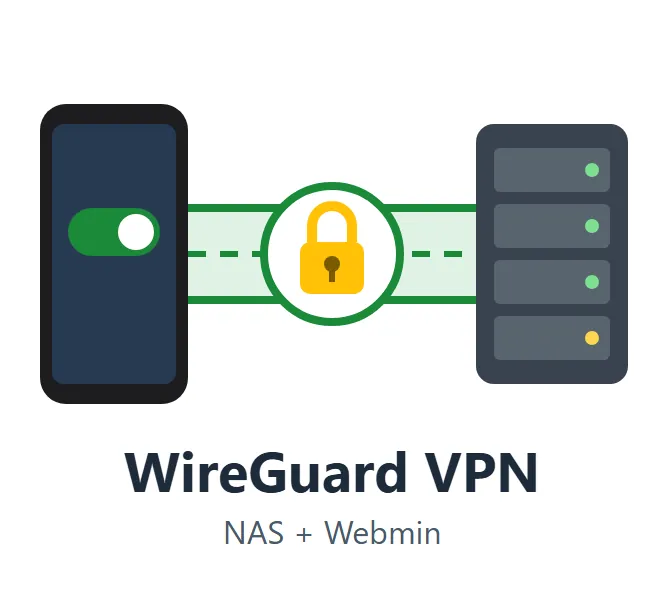
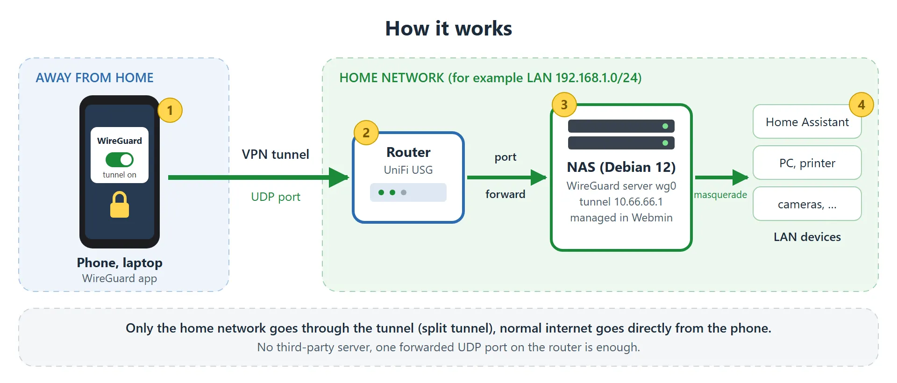

# Self-hosted WireGuard VPN for a home LAN

<p align="center"></p>

Slovak version: [citajma.md](citajma.md)

Reach your home network from a phone or laptop through a WireGuard tunnel that
runs on your own NAS (Debian 12). No third-party coordination server: you only
forward one UDP port on the router.

The project was built for a UniFi USG router (it has no VPN a phone can use),
a Debian 12 NAS and a Samsung Galaxy S25+, but nothing in it is specific to
those. The LAN and the DNS for clients are detected from the NAS network card
(its subnet and default gateway). Defaults: tunnel `10.66.66.0/24` and
`fd42:42:42::/64`, port `59656/udp`. All of them can be changed.

The solution suits any network where the router cannot provide a VPN connection
and a Linux device, such as a NAS or a Raspberry Pi, runs in the LAN behind it.

Comfortable configuration of the VPN tunnel and client management are available
through the Webmin module in the [`webmin/`](webmin/readme.md) subfolder.



## What is in the repository

| Path | What it is |
|------|------------|
| [`scripts/regen-wg.sh`](scripts/regen-wg.sh) | Sets up the WireGuard **server** on the NAS (packages, `wg0.conf`, firewall rules, forwarding, service), then calls `add-wg-client.sh`. |
| [`scripts/add-wg-client.sh`](scripts/add-wg-client.sh) | Creates or regenerates one **client**: keys, PSK, config, QR code (PNG and in the terminal). Private files are shredded afterwards. |
| [`webmin/`](webmin/readme.md) | A Webmin module (native Perl) that does the same from the browser, plus install detection, uninstall with cleanup and editing of the server settings. Available in 12 languages. |
| [`docs/setup.en.md`](docs/setup.en.md) | The full step-by-step guide (also in Slovak: [`docs/setup.md`](docs/setup.md)): router port forward, phone and Windows setup, troubleshooting, manual procedure. |

The scripts print English only.

## Quick start

On the NAS, as root:

```bash
sudo apt install wireguard iptables qrencode
chmod +x scripts/*.sh
sudo ./scripts/regen-wg.sh        # server + first device, shows a QR code
sudo ./scripts/add-wg-client.sh   # every further device
```

Then forward `UDP 59656` on the router to the NAS, scan the QR code in the
WireGuard app and switch the tunnel on. The details (CGNAT check, DDNS, Android
and Windows behaviour) are in [`docs/setup.en.md`](docs/setup.en.md).

To manage the VPN from Webmin instead, see [`webmin/readme.md`](webmin/readme.md).

## Security notes

- The scripts and the module run as root and put values into `wg0.conf`
  `PostUp`/`PostDown` lines, so the module validates every input strictly. Read
  the scripts before running them.
- Client private keys are shown once (QR code or file) and are not stored; the
  server keeps only the public keys.
- Never commit `wg0.conf`, client `.conf` files or keys. `.gitignore` blocks the
  common names, but check before you push.

## Testing status

- The Webmin module is verified on a live Webmin 2.670 (Debian 12): installation,
  server setup, server overview, install status, adding a client including its
  actual connection, and deleting a client. Settings edit and uninstall were
  verified only against a simulated environment.
- The shell scripts are syntax-checked (`bash -n`). Try a full run on a test
  machine before relying on them on your NAS.

## License

[MIT](LICENSE)
