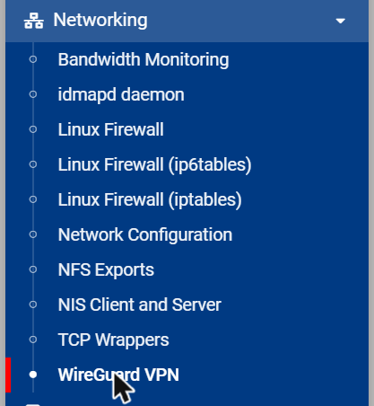
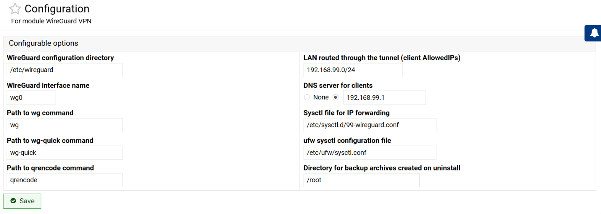
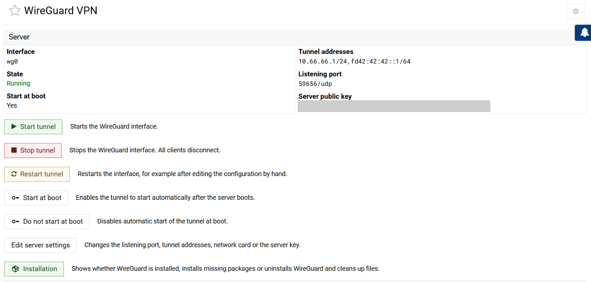
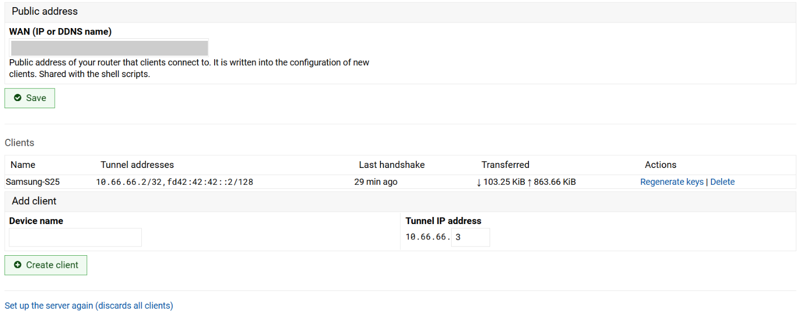
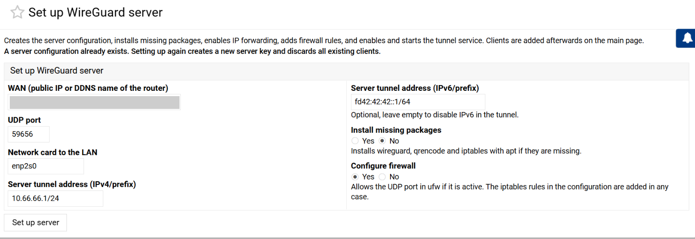
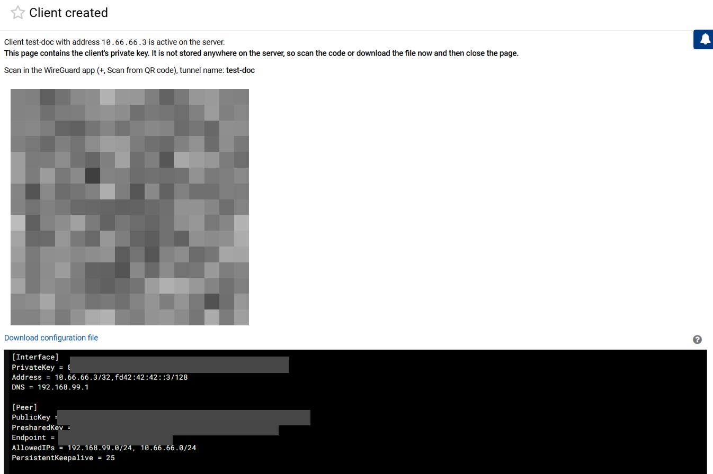
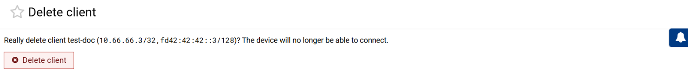
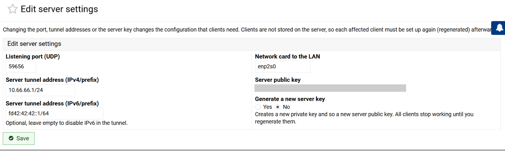
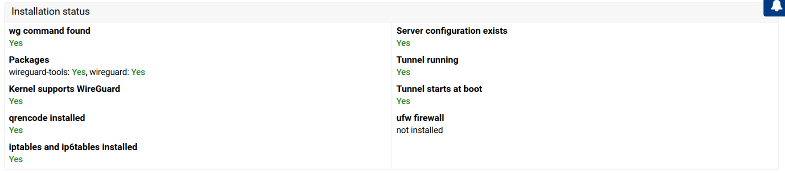
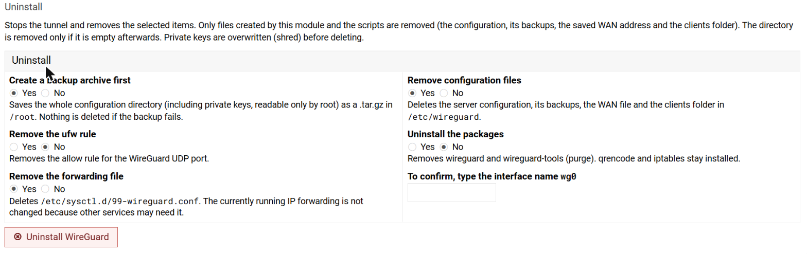

# Modul WireGuard VPN pre Webmin

Anglická verzia: [readme.md](readme.md)

Webmin modul na inštaláciu a správu WireGuard servera na NAS (Debian 12). Robí
to isté ako skripty `regen-wg.sh` a `add-wg-client.sh` z [`../scripts/`](../scripts/)
(prvotné nastavenie servera a správa klientov) a číta a zapisuje rovnaký formát
`/etc/wireguard/wg0.conf`, takže skripty a modul sa dajú používať striedavo.

Nie je to oficiálny modul Webminu (taký neexistuje), je to vlastný modul
v Perli. Jazyky: angličtina, slovenčina, nemčina, francúzština, španielčina, taliančina,
brazílska portugalčina, ruština, poľština, čeština, zjednodušená čínština a
japončina (pozri Jazyky).

## Čo modul vie

- **Prvotné nastavenie servera** (stránka **Set up server**, ako `regen-wg.sh`):
  - doinštaluje chýbajúce balíky (`wireguard`, `qrencode`, `iptables`) cez apt,
  - vygeneruje kľúč servera a zapíše `wg0.conf` s firewall pravidlami
    (`PostUp`/`PostDown`: povolí UDP port, forward z/do `wg0`, masquerade);
    starý `wg0.conf` zálohuje,
  - zapne IP forwarding (IPv4 aj IPv6) v `/etc/sysctl.d/99-wireguard.conf`,
  - ak je aktívny **ufw**, povolí v ňom UDP port a postará sa, aby jeho
    `/etc/ufw/sysctl.conf` nevypol forwarding (pri nftables s `policy drop`
    vypíše upozornenie),
  - zapne a spustí službu `wg-quick@wg0` (štartuje aj po reštarte),
  - skontroluje výsledok (služba beží a štartuje pri štarte, port počúva,
    forwarding, pravidlá firewallu) a ukáže `[OK]`/chyby krok za krokom,
  - vypíše, čo ostáva ručne na USG (port forward, pevná IP pre NAS, DDNS).
- **Stav inštalácie** (stránka **Installation**, aj na hlavnej stránke, keď
  chýba server): či je nainštalovaný príkaz `wg` a balíky `wireguard` a
  `wireguard-tools`, či jadro podporuje WireGuard, či sú `qrencode`,
  `iptables` a `ip6tables`, či existuje konfigurácia, či tunel beží a štartuje
  pri štarte a aký je stav `ufw`.
- **Inštalácia balíkov:** tlačidlo doinštaluje len chýbajúce balíky cez apt.
- **Odinštalovanie s bezpečným upratovaním** (pozri Odinštalovanie).
- **Úprava nastavení servera** (stránka **Edit server settings**): počúvací
  port, adresy servera v tuneli (IPv4 a IPv6), sieťová karta pre masquerade a
  pregenerovanie kľúča servera (nový verejný kľúč), pozri Úprava nastavení
  servera.
- **Prehľad servera:** stav tunela (beží/zastavený), spustenie pri štarte,
  adresy v tuneli, port, verejný kľúč servera.
- **Ovládanie tunela:** spustiť, zastaviť, reštartovať, zapnúť/vypnúť spustenie
  pri štarte (`wg-quick@wg0`).
- **Zoznam klientov:** názov, adresy v tuneli, čas posledného handshaku a
  objem prenesených dát (z `wg show`).
- **Pridanie klienta:** názov a posledné číslo IP adresy (ponúkne prvú voľnú).
  Modul vygeneruje kľúče a PSK, pridá peera do `wg0.conf` a načíta zmenu cez
  `wg syncconf`, takže ostatní klienti sa neodpoja.
- **QR kód v prehliadači** a **stiahnutie `.conf`** (pre Windows/PC) hneď po
  vytvorení klienta.
- **Pregenerovanie kľúčov** existujúceho klienta (po potvrdení) a **zmazanie**
  klienta (po potvrdení).
- **Verejná adresa (WAN):** zadáva sa na hlavnej stránke, ukladá sa do
  `/etc/wireguard/.endpoint` a zdieľa sa so skriptami.
- Záznamy v Webmin Actions Log (vytvorenie, pregenerovanie, zmazanie klienta,
  ovládanie tunela, zmena WAN).

## Čo modul nerobí

- **Nenastavuje USG (router).** Port forward, pevnú IP pre NAS a DDNS treba
  nastaviť ručne v UniFi, modul ich len pripomenie. Nevie ani zistiť, či je USG
  za CGNAT (porovnaj WAN IP v UniFi s <https://ifconfig.me>).
- **Neukladá konfigurácie klientov.** Preto po zmene portu, adries v tuneli
  alebo kľúča servera treba každého klienta nastaviť znova (pregenerovať, pozri
  Úprava nastavení servera).
- **Neukladá súkromné kľúče klientov.** Zobrazia sa jednorazovo na stránke po
  vytvorení klienta, potom už nikde nie sú (server má len verejný kľúč). Ak ich
  stratíš, pregeneruj kľúče klienta.

## Požiadavky

- Webmin na Debiane 12 (overené na Webmin 2.670, pozri Stav testovania).
- Balíky `wireguard`, `qrencode` a `iptables`: nainštaluje ich nastavenie
  servera (voľba **Install missing packages**), alebo ich nainštaluj ručne.
- Server vytvorený nastavením v module, skriptom `regen-wg.sh` alebo `wg0.conf`
  v rovnakom formáte (pozri Formát konfigurácie).
- Webmin musí bežať ako root (štandardné nastavenie), kvôli `wg`, `systemctl`,
  `apt-get`, `ufw` a zápisu do `/etc/wireguard`.

## Inštalácia

### Cez Webmin (odporúčané)

1. Získaj `wireguard.wbm.gz`: stiahni ho zo stránky **Releases** repozitára alebo
   si ho zostav sám cez `./build.sh` (pozri Zostavenie balíka). Skopíruj ho na počítač, z ktorého
   otváraš Webmin.
2. Webmin → **Webmin Configuration** → **Webmin Modules** → **From uploaded
   file**, vyber `wireguard.wbm.gz` a klikni na **Install Module**.
3. Modul sa zobrazí v kategórii **Networking** ako **WireGuard VPN**. Ak ho
   nevidíš, obnov stránku alebo použi **Refresh Modules**.

   

4. Iným Webmin používateľom ho sprístupni cez **Webmin Users** (modul vie
   spravovať VPN a čítať privátne kľúče, dávaj ho len dôveryhodným účtom).

### Ručne

Skopíruj priečinok `wireguard/` na NAS do adresára Webminu (na Debiane
`/usr/share/webmin/`), nastav skriptom práva a obnov zoznam modulov:

```bash
sudo cp -r wireguard /usr/share/webmin/
sudo chmod 755 /usr/share/webmin/wireguard/*.cgi
```

Potom vo Webmine **Refresh Modules**. Cestu k adresáru Webminu zistíš z
`grep ^root= /etc/webmin/miniserv.conf`.

## Nastavenie

Hlavná stránka modulu → ozubené koleso (**Module Config**):



| Voľba | Predvolená hodnota | Význam |
|-------|--------------------|--------|
| WireGuard configuration directory | `/etc/wireguard` | Kde je `wg0.conf` a `.endpoint`. |
| WireGuard interface name | `wg0` | Názov rozhrania. |
| Path to wg / wg-quick / qrencode | `wg`, `wg-quick`, `qrencode` | Cesty k príkazom. |
| LAN routed through the tunnel | `auto` | `AllowedIPs` v konfigurácii klientov (okrem tunelovej podsiete). `auto` použije podsieť sieťovej karty servera. |
| DNS server for clients | `auto` | `DNS` v konfigurácii klientov. `auto` použije predvolenú bránu tejto karty, None = bez DNS. |
| Directory for backup archives created on uninstall | `/root` | Kam sa uloží záloha pri odinštalovaní. |
| Sysctl file for IP forwarding | `/etc/sysctl.d/99-wireguard.conf` | Kam nastavenie servera zapíše forwarding. |
| ufw sysctl configuration file | `/etc/ufw/sysctl.conf` | Súbor ufw, v ktorom sa zapne forwarding, ak je ufw aktívny. |

Verejnú adresu USG (WAN) nastavíš priamo na hlavnej stránke, nie v Module
Config. Hodnoty zodpovedajú predvoleným hodnotám skriptov.

## Použitie

### Hlavná stránka

Prehľad servera (rozhranie, stav, spustenie pri štarte, adresy, port, verejný
kľúč) a tlačidlá na ovládanie tunela, úpravu nastavení servera a inštaláciu:



Pod tým je verejná adresa (WAN), zoznam klientov s časom posledného handshaku
a prenesenými dátami a formulár na pridanie klienta. Verejný kľúč servera a
WAN sú na obrázkoch zakryté:



### Postup

0. **Prvé nastavenie servera.** Ak server ešte neexistuje, hlavná stránka
   ponúkne tlačidlo **Set up server**. Vyplň WAN (verejná IP alebo DDNS meno
   USG), UDP port (predvolene `59656`), sieťovú kartu do LAN (zistí sa sama),
   adresy servera v tuneli (`10.66.66.1/24`, voliteľne IPv6
   `fd42:42:42::1/64`) a voľby inštalácie balíkov a firewallu, potom klikni na
   **Set up server**. Stránka ukáže priebeh a kontrolu krok za krokom. Na
   konci vypíše, čo treba ešte spraviť na USG (port forward, pevná IP, DDNS).
   Ak server už existuje, nové nastavenie zahodí všetkých klientov a vyžiada
   potvrdenie. Vstupy sa prísne validujú, lebo sa dostávajú do `PostUp`
   príkazov, ktoré sa spúšťajú ako root.

   

1. **Skontroluj WAN** na hlavnej stránke (po nastavení servera je vyplnený).
2. V sekcii **Add client** zadaj názov zariadenia (písmená, čísla, `_`, `-`)
   a posledné číslo IP (`10.66.66.` + číslo, od 2 do 254, predvolene prvá
   voľná) a klikni na **Create client**.
3. Na stránke s výsledkom naskenuj QR v aplikácii WireGuard na telefóne
   (**+** → **Scan from QR code**), alebo pre Windows/PC klikni na **Download
   configuration file** a importuj súbor do aplikácie WireGuard.
4. Stránku potom zavri, súkromný kľúč sa už nikde neukladá.

   

5. Ak IP už používa iný klient, modul upozorní, že pregenerovanie zneplatní
   starého klienta, a vyžiada potvrdenie. Rovnaký názov pre dve rôzne IP
   modul odmietne.

Ak tunel nebeží, zmena sa zapíše do `wg0.conf` a klient sa aktivuje po
spustení tunela. Ak beží, zmena sa načíta okamžite a ostatní klienti zostanú
pripojení.

**Zmazanie klienta:** v zozname klientov klikni na **Delete**, modul ukáže
potvrdenie s názvom a adresami klienta a po potvrdení ho odstráni z `wg0.conf`
a z bežiaceho tunela. Ostatní klienti zostanú pripojení.



**Pregenerovanie kľúčov:** **Regenerate keys** otvorí formulár s predvyplneným
názvom a IP. Po odoslaní modul upozorní, že pôvodné zariadenie prestane
fungovať, a po potvrdení vytvorí nové kľúče a QR kód.

## Úprava nastavení servera

Hlavná stránka → **Edit server settings**. Formulár je predvyplnený aktuálnymi
hodnotami z `wg0.conf` (verejný kľúč je na obrázku zakrytý):



| Voľba | Čo modul urobí |
|-------|----------------|
| Listening port | Zmení `ListenPort` aj číslo portu v pravidlách `PostUp`/`PostDown`. V ufw (ak je aktívny) odstráni staré pravidlo a pridá nové. |
| Server tunnel address (IPv4/IPv6) | Zmení `Address`. Ak sa zmení podsieť, **presunie aj všetkých klientov** do novej podsiete (rovnaké posledné číslo, napr. `10.66.66.12` na `10.77.77.12`). IPv6 sa dá odstrániť prázdnym poľom. |
| Network card | Nahradí názov karty v pravidlách (`FORWARD`, `MASQUERADE`). |
| Generate a new server key | Vytvorí nový súkromný kľúč, teda nový verejný kľúč servera. |

Správanie:

- Pred uložením vždy vznikne záloha `wg0.conf.bak.<dátum-čas>`.
- Bežiaci tunel sa reštartuje, aby sa použili nové pravidlá a adresy.
- Adresa servera nesmie končiť číslom, ktoré už používa klient.
- **Konfigurácie klientov sa neukladajú.** Po zmene portu, adries alebo kľúča
  prestanú existujúci klienti fungovať, kým každého nepregeneruješ (nový
  `Endpoint`, `Address` alebo kľúč servera v klientovi). Modul preto pred
  zmenou ukáže zoznam zmien a požiada o potvrdenie a po zmene vypíše odkazy na
  pregenerovanie každého klienta.
- Port sa mení aj na USG: po zmene portu uprav port forward v UniFi na nový
  port.

## Odinštalovanie

Hlavná stránka → **Installation**. Horná časť ukazuje stav inštalácie
(príkaz `wg`, balíky, jadro, `qrencode`, `iptables`, konfigurácia, tunel, `ufw`):



V sekcii **Uninstall** vyber, čo sa má odstrániť, a na potvrdenie napíš názov
rozhrania (`wg0`):



Modul vykoná tieto kroky v tomto poradí:

1. **Záloha** (voliteľné, predvolene zapnuté): celý konfiguračný adresár
   ako `wireguard-backup-<dátum-čas>.tar.gz` (predvolene v `/root`, práva
   `600`). Ak záloha zlyhá, nič sa nezmaže.
2. **Zastavenie a vypnutie** služby `wg-quick@wg0` (`PostDown` odstráni
   pravidlá iptables) a v prípade potreby zrušenie rozhrania.
3. **Pravidlo v ufw** pre UDP port (voliteľné).
4. **Súbor s forwardingom** `/etc/sysctl.d/99-wireguard.conf` (voliteľné).
   Bežiaci forwarding sa nemení, lebo ho môžu potrebovať iné služby, a úprava
   `/etc/ufw/sysctl.conf` z nastavenia servera sa nevracia.
5. **Konfiguračné súbory** (voliteľné): maže sa len `wg0.conf`, jeho zálohy
   `wg0.conf.bak.*`, `.endpoint` a súbory v `clients/`. Súkromné kľúče sa pred
   zmazaním prepíšu (`shred`). Adresár `/etc/wireguard` sa odstráni len ak je
   potom prázdny, inak ostane (s upozornením) a iné súbory sa nedotknú.
6. **Balíky** (voliteľné, predvolene vypnuté): `apt-get remove --purge
   wireguard wireguard-tools`. `qrencode` a `iptables` ostanú nainštalované.

Ochrana pred chybou: modul odmietne čistiť adresár, ktorý nie je absolútna
cesta aspoň s dvoma zložkami (napr. `/etc/wireguard`), a nikdy nemaže adresáre
rekurzívne.

## Formát konfigurácie

Modul rozoznáva klientov podľa formátu, ktorý vytvárajú skripty. Pri ručných
úpravách `wg0.conf` ho zachovaj:

```ini
[Interface]
Address = 10.66.66.1/24,fd42:42:42::1/64
ListenPort = 59656
PrivateKey = ...
PostUp = ...

### Client SamsungS25
[Peer]
PublicKey = ...
PresharedKey = ...
AllowedIPs = 10.66.66.2/32,fd42:42:42::2/128
```

- Bloky sú oddelené prázdnym riadkom.
- Názov klienta je v komentári `### Client <názov>` bezprostredne pred
  `[Peer]`.
- Prvá položka v `AllowedIPs` je IPv4 adresa klienta (`/32`) a určuje jeho
  poradové číslo.
- `[Interface]` musí obsahovať `Address` (IPv4, voliteľne aj IPv6),
  `ListenPort` a `PrivateKey`.

Pri každej zmene vytvorí modul zálohu `wg0.conf.bak.<dátum-čas>` (práva `600`)
rovnako ako skripty. Staré zálohy sa nemažú, zmaž ich ručne.

## Bezpečnosť

- Stránka po vytvorení klienta obsahuje **súkromný kľúč klienta** (QR kód,
  odkaz na stiahnutie a text). Používaj Webmin len cez **HTTPS** a stránku po
  naskenovaní zavri. Kľúč sa neukladá, ale zostáva v histórii prehliadača
  zobrazenej stránky, kým ju nezavrieš. QR sa vytvára cez `data:` URI, takže sa
  nezapisuje ako súbor na server.
- Dočasné súbory pri tvorbe QR (`qrencode` číta konfiguráciu zo súboru) sa
  vytvárajú v adresári Webminu s právami `600` a hneď po použití sa mažú.
- Modul beží s právami Webminu (root). Kto má k modulu prístup, môže pridávať
  a mazať VPN klientov, zastaviť tunel, inštalovať balíky (`apt-get`) a meniť
  pravidlá firewallu a `wg0.conf` (vrátane príkazov `PostUp`, ktoré spúšťa root).
  Prístup obmedz cez **Webmin Users**.
- Hodnoty zo formulára nastavenia servera (WAN, port, karta, adresy) sa pred
  zápisom do `wg0.conf` prísne kontrolujú, aby sa do `PostUp` nedostali
  vlastné príkazy. Rovnaká kontrola platí pri úprave nastavení servera.
- Záloha z odinštalovania obsahuje súkromné kľúče (server aj klientov, ak ich
  máš uložené). Má práva `600` a patrí rootovi. Po overení, že ju
  nepotrebuješ, ju bezpečne zmaž (`shred -u`). Odinštalovanie vyžaduje
  napísanie názvu rozhrania, aby sa nespustilo omylom.
- Ak niekto získa prístup k Webminu, získa aj kľúče nových klientov. Zabezpeč
  Webmin silným heslom a 2FA.

## Stav testovania

### Na živom serveri

Prostredie: Webmin 2.670 s témou Authentic 26.70 na Debiane 12 (jadro 6.1),
existujúci server `wg0` vytvorený externým skriptom s jedným klientom.

Overené:

- **Inštalácia modulu** z `wireguard.wbm.gz` cez Webmin Modules (modul sa zaradil
  do **Networking**, `/usr/share/webmin/wireguard`).
- **Hlavná stránka** správne prečítala existujúci server: stav, spustenie pri
  štarte, adresy, port, verejný kľúč, klienta s časom posledného handshaku a
  prenesenými dátami.
- **Installation:** všetky kontroly vyšli správne (príkaz `wg`, balíky, jadro,
  `qrencode`, `iptables`, konfigurácia, tunel beží a štartuje pri štarte, `ufw`
  nie je nainštalovaný).
- **Set up server:** nastavenie servera prebehlo na živom serveri a funguje.
- **Edit server settings a Module Config:** formuláre sa zobrazili a sú
  predvyplnené správnymi hodnotami (len zobrazenie, nič sa neuložilo ani
  neodoslalo).
- **Pridanie klienta** (testovací klient na voľnej IP): modul vytvoril klienta,
  zobrazil QR kód, konfiguráciu a odkaz na stiahnutie a klient sa objavil v
  zozname. Klient vytvorený modulom sa aj skutočne pripojil.
- **Zmazanie klienta:** potvrdenie a odstránenie testovacieho klienta. Pôvodný
  klient ostal v zozname a jeho handshake sa nezmenil, teda zmena ho
  neprerušila.

**Neotestované** na živom serveri: uloženie zmeny nastavení servera (port,
adresy, karta, kľúč), pregenerovanie kľúčov, odinštalovanie, inštalácia balíkov,
tlačidlá Start/Stop/Restart a `ufw` (nie je nainštalovaný).

Poznámka k Webminu: stránky modulu sa nedajú otvoriť priamym odkazom, Webmin
ukáže „Security Warning“ (kontrola referera). Modul otváraj klikaním cez menu.
Bezpečnostné nastavenie `referers_none` kvôli tomu nemeň.

### Na simulovanom prostredí

Úprava konfigurácie bola otestovaná v Perli na Windows so zástupnými príkazmi
`wg` a `qrencode`:

- čítanie a zápis `wg0.conf`, pridanie, pregenerovanie a zmazanie klienta,
  validácia vstupov, zálohy, QR vo formáte base64,
- nastavenie servera so zástupnými príkazmi `systemctl`, `sysctl`, `ss`,
  `iptables`, `ufw`, `apt-get`, `ip`: zápis `wg0.conf` s `PostUp`/`PostDown`,
  `.endpoint`, sysctl súbor, úprava ufw sysctl, volanie `ufw allow`,
  zapnutie a štart služby, kontroly, inštalácia chýbajúcich balíkov, odmietnutie
  nebezpečných vstupov (napr. `;`, `$(...)` v WAN, karte alebo porte),
- stav inštalácie, doinštalovanie balíkov, odinštalovanie (záloha, zastavenie
  služby, ufw, sysctl, mazanie len vlastných súborov, ponechanie cudzích
  súborov a adresára, odstránenie prázdneho adresára, odmietnutie nebezpečnej
  cesty ako `/etc` alebo `/etc/../x`, zastavenie pri zlyhaní zálohy),
- úprava servera: zmena portu, adries (vrátane presunu klientov do novej
  podsiete a odstránenia IPv6), karty a kľúča, odmietnutie adresy, ktorú už
  používa klient, volania ufw a reštart služby,
- syntax všetkých `.cgi`/`.pl` súborov (`perl -c`) a kontrola, že všetky
  textové kľúče existujú v každom jazykovom súbore s rovnakými zástupnými znakmi (`$1`, `$2`).

Pri prvom použití neotestovaných častí na vlastnom serveri si over výsledok
(`sudo wg show`, kontrola `[OK]` po nastavení servera) a pred zmenou vytvor
zálohu `/etc/wireguard`.

Ak niečo nefunguje, pozri chybu v **Webmin → Webmin Actions Log** a
`/var/webmin/miniserv.error`.

## Riešenie problémov

| Problém | Čo skontrolovať |
|---------|-----------------|
| „Security Warning“ pri otvorení stránky | Webmin blokuje priame odkazy (kontrola referera). Otvor modul klikaním cez menu **Networking → WireGuard VPN**. |
| Modul sa nezobrazí | Obnov **Refresh Modules**, skontroluj práva používateľa, v Webmin Users mu modul pridaj. |
| „Príkaz WireGuard sa nenašiel“ | `apt install wireguard qrencode` alebo nastav cestu v Module Config. |
| „Konfiguračný súbor neexistuje“ | Klikni na **Set up server**, alebo nastav správny priečinok a rozhranie v Module Config. |
| Nastavenie servera skončí chybou pri balíkoch | Over `apt-get update` na NAS, alebo balíky nainštaluj ručne a nastavenie zopakuj. |
| Kontrola `[CHYBA]` po nastavení | Pozri `systemctl status wg-quick@wg0` a `journalctl -u wg-quick@wg0`, najčastejšie je obsadený port alebo chýba `iptables`. |
| „Konfigurácia nie je platná“ | `[Interface]` musí mať `Address` (IPv4), `ListenPort` a `PrivateKey`. |
| „Verejná adresa nie je nastavená“ | Vyplň WAN na hlavnej stránke modulu. |
| QR sa nezobrazí | Over `qrencode`, použi odkaz na stiahnutie alebo text konfigurácie. |
| Zmena sa uložila, ale načítanie zlyhalo | Pozri správu na stránke. Reštartuj tunel tlačidlom **Restart tunnel**. |
| Klient sa nepripojí | Rovnaké kontroly ako v [setup.md](../docs/setup.md) (port forward na USG, CGNAT, forwarding). |

## Odstránenie modulu z Webminu

(Toto odstráni len modul, nie WireGuard. WireGuard odinštaluješ v module,
pozri Odinštalovanie vyššie.)

Webmin → **Webmin Configuration** → **Webmin Modules** → **Delete** a vyber
modul **WireGuard VPN**. Konfigurácia WireGuardu (`/etc/wireguard`) ostane
nedotknutá. Ručne nainštalovaný modul odstrániš takto:

```bash
sudo rm -rf /usr/share/webmin/wireguard
```

## Obsah priečinka

| Súbor | Účel |
|-------|------|
| `build.sh` | Zostaví inštalačný balík `wireguard.wbm.gz` z priečinka `wireguard/` (balík nie je v gite, zverejni ho ako Release). |
| `wireguard/module.info` | Názov, kategória a popis modulu. |
| `wireguard/config`, `config.info`, `config.info.<jazyk>` | Predvolené nastavenia a ich popisy. |
| `wireguard/wireguard-lib.pl` | Spoločné funkcie: čítanie a zápis `wg0.conf`, generovanie kľúčov, QR, ovládanie tunela. |
| `wireguard/index.cgi` | Hlavná stránka: server, WAN, klienti, pridanie klienta. |
| `wireguard/install.cgi` | Stav inštalácie, inštalácia balíkov a formulár odinštalovania. |
| `wireguard/install_pkgs.cgi` | Doinštalovanie chýbajúcich balíkov. |
| `wireguard/uninstall.cgi` | Odinštalovanie s upratovaním a výpisom krokov. |
| `wireguard/edit_server.cgi`, `save_server.cgi` | Úprava portu, adries, karty a kľúča servera s potvrdením. |
| `wireguard/setup.cgi` | Formulár prvotného nastavenia servera. |
| `wireguard/setup_server.cgi` | Vykonanie nastavenia servera, potvrdenie prepísania, výpis krokov a kontrol. |
| `wireguard/add_client.cgi` | Formulár na pridanie a pregenerovanie klienta. |
| `wireguard/save_client.cgi` | Vytvorenie klienta, potvrdenie pregenerovania, zobrazenie QR. |
| `wireguard/delete_client.cgi` | Zmazanie klienta s potvrdením. |
| `wireguard/service.cgi` | Štart, stop, reštart, spustenie pri štarte. |
| `wireguard/save_endpoint.cgi` | Uloženie verejnej adresy (WAN). |
| `wireguard/log_parser.pl` | Čitateľné záznamy v Webmin Actions Log. |
| `wireguard/lang/<jazyk>` | Texty (12 jazykov, pozri Jazyky). |
| `wireguard/images/icon.gif` | Ikona modulu. |
| `docs/img/*.png` | Orezané screenshoty stránok modulu použité v tomto dokumente (kľúče, QR a WAN sú zakryté). |

## Jazyky

Modul používa jazyk zvolený vo Webmine (**Webmin Configuration** → **Language
and Locale**). K dispozícii sú: `en` (angličtina, zdrojové texty), `sk`, `de`,
`fr`, `es`, `it`, `pt_BR`, `ru`, `pl`, `cs`, `zh_CN` a `ja`. Pri inom jazyku sa
použije angličtina.

Len `en` a `sk` napísal autor. Ostatné preklady sú strojové a rodení hovoriaci
ich nekontrolovali, takže formulácie môžu byť miestami nepresné. Opravy vítame
ako pull requesty.

Nový jazyk pridáš tak, že skopíruješ `wireguard/lang/en` do
`wireguard/lang/<kód>` (kód jazyka vo Webmine, napr. `tr` alebo `nl`),
preložíš text za každým `=` a kľúče aj zástupné znaky `$1`, `$2` ponecháš.
Voliteľne pridaj `config.info.<kód>` a riadok `longdesc_<kód>` do `module.info`.

## Zostavenie balíka

Po zmene súborov v `wireguard/` vytvor balík znova (v priečinku `webmin`):

```bash
./build.sh
```

Skript nastaví práva a vytvorí `wireguard.wbm.gz` vedľa seba (súbor je v
`.gitignore`, pripoj ho k verzii na GitHube cez Releases).
